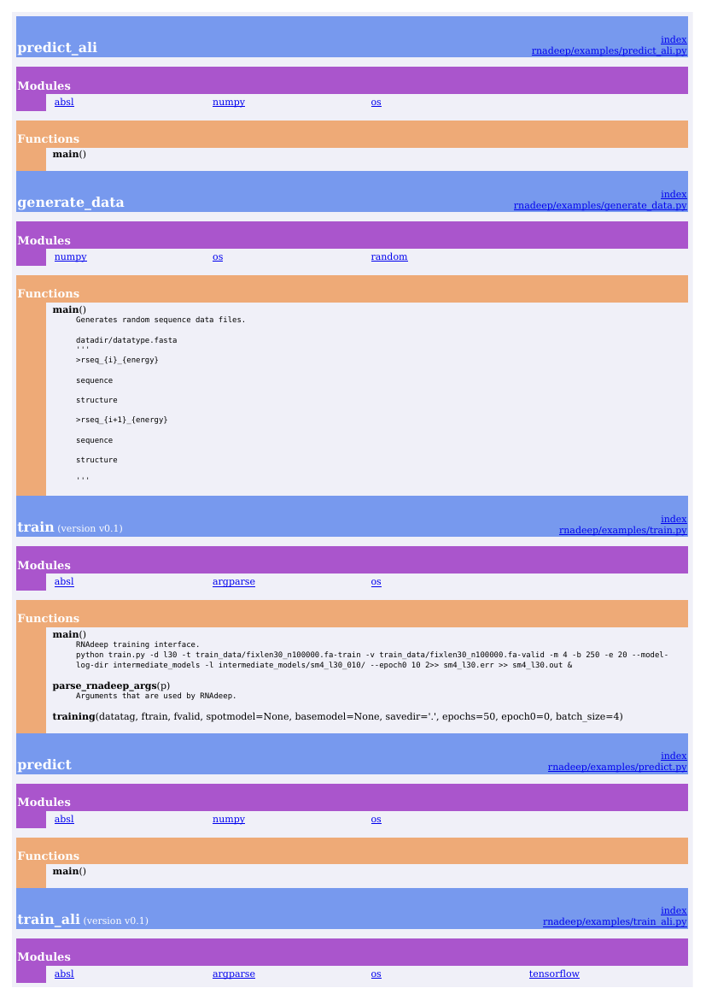

## INSTALLATION
- Create a virtual environment: `conda env create -n rnadeep --file rnadeep.yaml`
- Run `pip install -r requirements` in root.

## DIRECTORIES
* *rnadeep*: The nessecary tools to sample and encode the learning data, the spotrna models, and important metrics.
* *rnaconv*: Contains the rfam database as well as multiple tools to generate artifical data in different ways using RNAfold3 and SISSI4. Refer to `rnaconv/ReadMe.md`
* *examples*: Example python, bash and slurm scripts to train and predict data. Refer to `examples/ReadMe.md`

## REFS
* 3https://github.com/ViennaRNA 
* 4https://cibiv.github.io/software/sissi 

## DOCUMENTATION

